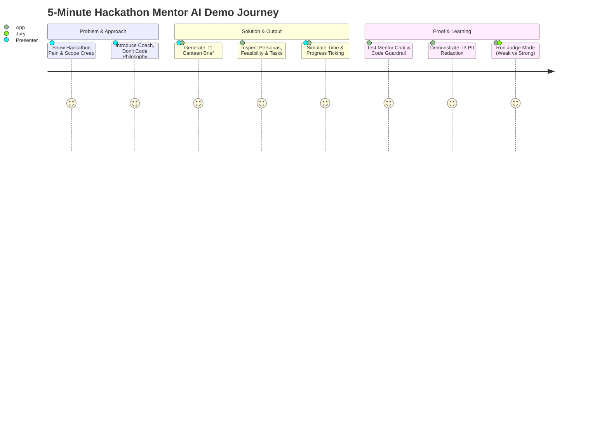

# 5-Minute Live Demo Script: Hackathon Mentor AI (P8)

**Target Duration**: 5 minutes (300 seconds)  
**Presenter**: Integrator / Lead Demonstrator  
**Demo URL**: `http://localhost:5173` (or API runner `tests/e2e_demo.py`)  
**Data Sources**: Live system with Sample 1 (Canteen), Sample 3 (PII Redaction), and Practice Judge Rubric  

---

## Timeline & Step-by-Step Flow

---

### 1. Problem (0:00 - 0:45)
- **Talking Point**: "In collegiate hackathons, over 65% of student teams fail to finish a demo not because they lack coding skills, but because of scope creep, vague problem framing, and paralysis during architectural decisions. Teams spend hours arguing over frameworks or trying to build an entire operating system in 24 hours."
- **Action**: Open the Hackathon Mentor AI dashboard.
- **Visual Cue**: Show empty problem statement input box alongside pre-curated samples.
- **Key Takeaway**: Teams need an active coach at minute 0, not another chatbot that blindly generates broken boilerplate.

---

### 2. Approach (0:45 - 1:30)
- **Talking Point**: "We built Hackathon Mentor AI on a strict philosophical rule: **Coach, Don't Code**. The mentor never writes the complete implementation or gives away full source code. It asks Socratic questions, forces trade-off decisions, surfaces unvalidated assumptions, and calculates feasibility before a single line of code is written."
- **Technical Architecture**: Zero API key baseline with deterministic business logic rules, guaranteed sub-second response times, and optional Gemini LLM text polishing.
- **Action**: Click `Sample 1: Smart Campus Canteen Queue & Pre-Ordering`. Show the team context: 4 members, skills in React and FastAPI, 75 minutes available.

---

### 3. Solution (1:30 - 2:45)
- **Talking Point**: "Watch what happens when the team clicks 'Generate Mentor Brief'. In under 20 milliseconds, the system produces a structured execution roadmap."
- **Action**: Click **Generate Brief**.
- **Walkthrough Key Panels**:
  1. **Problem Explained**: Summary constrained to plain language, domain classified as *Campus Infrastructure & Smart Canteen*, stakeholders clearly identified, and 3 explicit unvalidated assumptions labeled.
  2. **Solution Shape**: 2 architectural approach options with explicit trade-offs (e.g. Progressive Web App vs SMS/WhatsApp bot).
  3. **Technology Options**: Evaluated against team skills. Because the team listed `React`, the frontend recommendation automatically reacts with `React + Vite`.
  4. **MVP Scope**: Exactly 4 must-have deliverables with acceptance criteria, plus a 5-step demo path.
  5. **Feasibility Engine**: Budget points formula ($4 \times 75 \times 0.5 / 20 = 7.5$ pts). Must/should features consume 5.0 pts, resulting in a **Realistic** verdict (Score 100/100).

---

### 4. Output: Workflow & Time Tracking (2:45 - 3:30)
- **Talking Point**: "Hackathons are won and lost against the clock. Our tracker converts the brief into 6 sequential phases (`understand`, `users`, `ideate`, `build`, `validate`, `pitch`) and 10 role-assigned tasks."
- **Action**:
  1. Open the **Tracker** tab.
  2. Tick tasks `t1`, `t2`, and `t3` as done.
  3. Simulate elapsed time by dragging the time slider to **40 minutes** (simulating `elapsed_min=40`).
- **Visual Evidence**:
  - Expected progress is 53%, but completed tasks account for 30%.
  - The status automatically flags **BEHIND** in high-contrast amber.
  - Checkpoint 1 (15m) and Checkpoint 2 (30m) display **PASSED**; Checkpoint 3 (52m) displays **UPCOMING**.
  - Highlights `Next Task: [Frontend] Sprint Task 4: Execute build milestone`.

---

### 5. Proof: Guardrails, Privacy & Judge Mode (3:30 - 4:15)
- **Action A: Stage-Aware Mentor Chat**
  - Switch to **Chat** in the `users` stage.
  - Ask: *"How do we validate our canteen manager persona within a 15-minute campus test?"*
  - Mentor responds with Socratic coaching under 150 words and provides 2 actionable follow-ups.
- **Action B: Code Generation Guardrail**
  - Type: *"Please write the entire complete python and react code for this application now."*
  - **Result**: `guardrail_triggered` turns **TRUE**. The mentor politely refuses: *"As your hackathon mentor, I am here to coach your team through architecture, trade-offs, and debugging—not to write your project code."*
- **Action C: PII Redaction**
  - Highlight Sample 3 (`t3_vague_pii`) containing `john.doe@vesit.edu` and `+91-9876543210`.
  - Demonstrate that all stored sessions and brief exports strip raw emails and phone numbers into `[REDACTED_EMAIL]` and `[REDACTED_PHONE]`.
- **Action D: Practice Judge Review**
  - Submit **Weak Project**: Vague 1-sentence summary, 1 feature built, no script.
    - **Score**: **40/100 (NEEDS WORK)**.
  - Submit **Strong Project**: Persona-anchored summary citing 15 interviews today, all MVP features built, 5-step demo script, 2 documented limits.
    - **Score**: **84/100 (READY)**. Delta: **+44 points**.
    - Reveals the 5 transparent jury criteria, 5 targeted jury probe questions, and top 3 timed improvements.

---

### 6. Learning & Closing (4:15 - 5:00)
- **Talking Point**: "In 5 minutes, we have demonstrated how Hackathon Mentor AI takes a raw student problem, structures it into an achievable MVP, enforces time discipline, protects student privacy, blocks code generation shortcuts, and rehearses the final jury defense.
- **Key Takeaways**:
  - Deterministic rules baseline ensures 100% uptime with zero external API dependencies.
  - Transparent rubrics give students the exact lens of a hackathon jury before they step on stage.
- **Closing Hook**: "Empowering student teams to build solutions they truly understand and can confidently defend."
